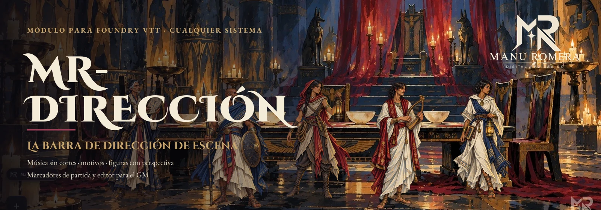
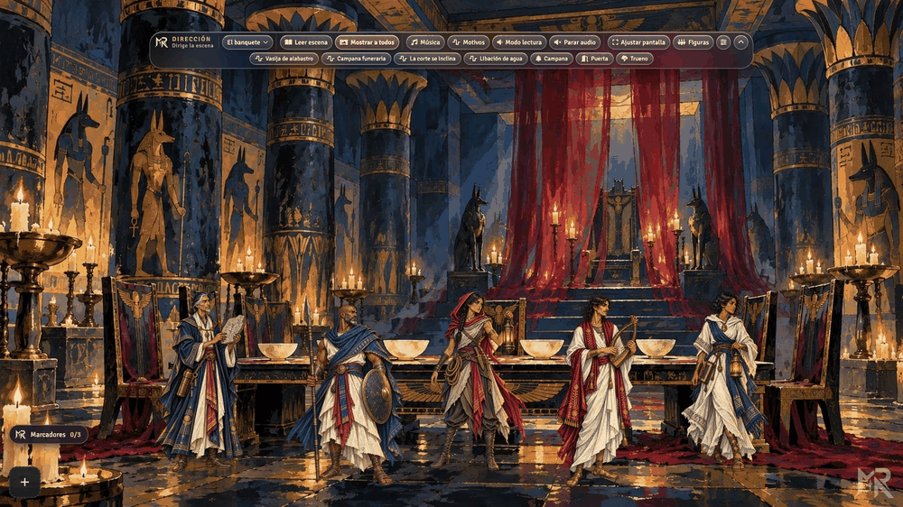
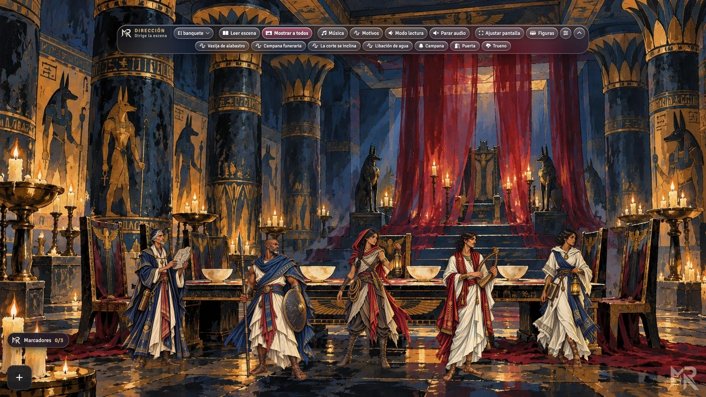
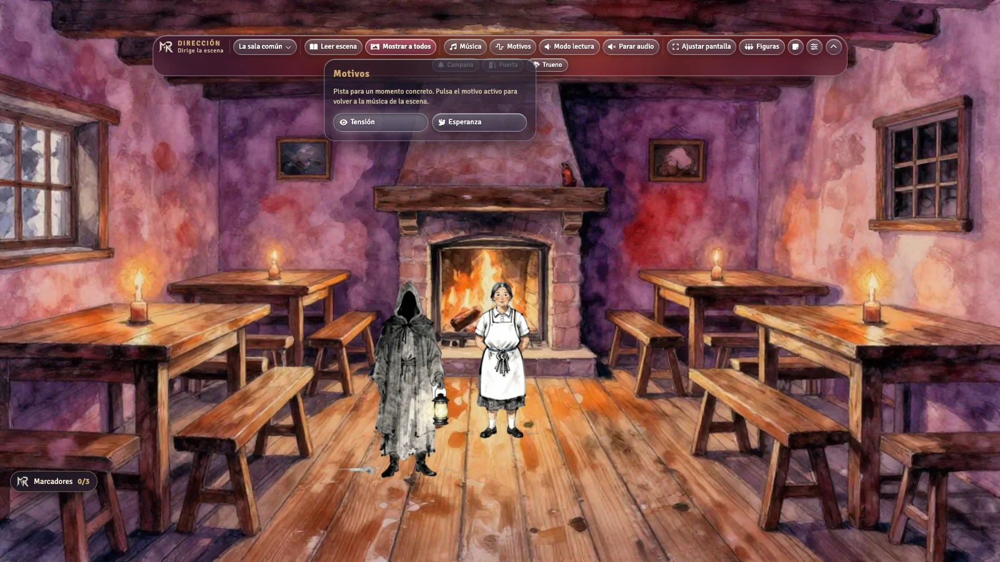
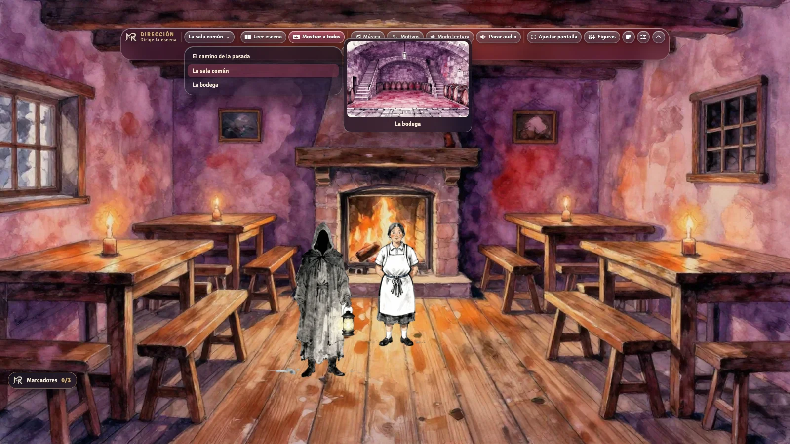
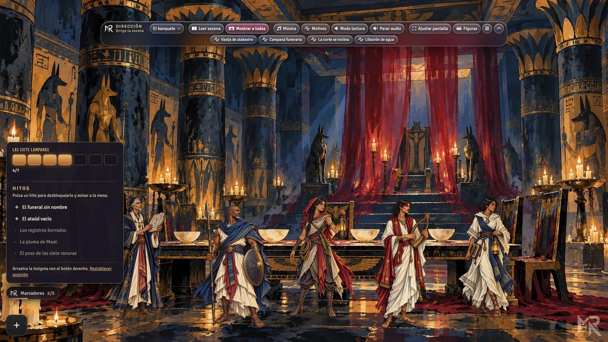
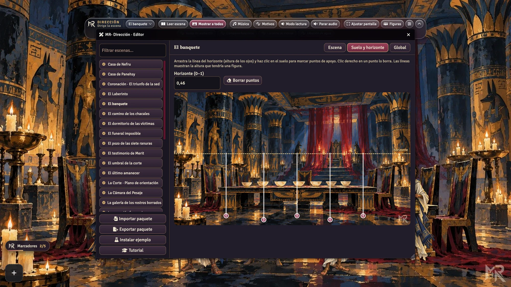
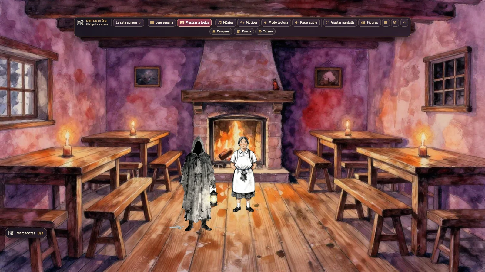
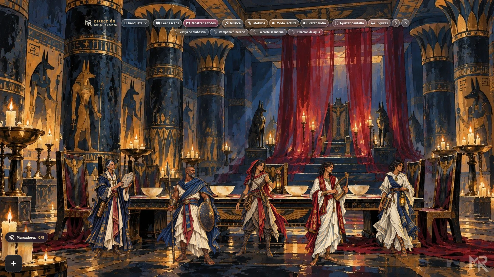
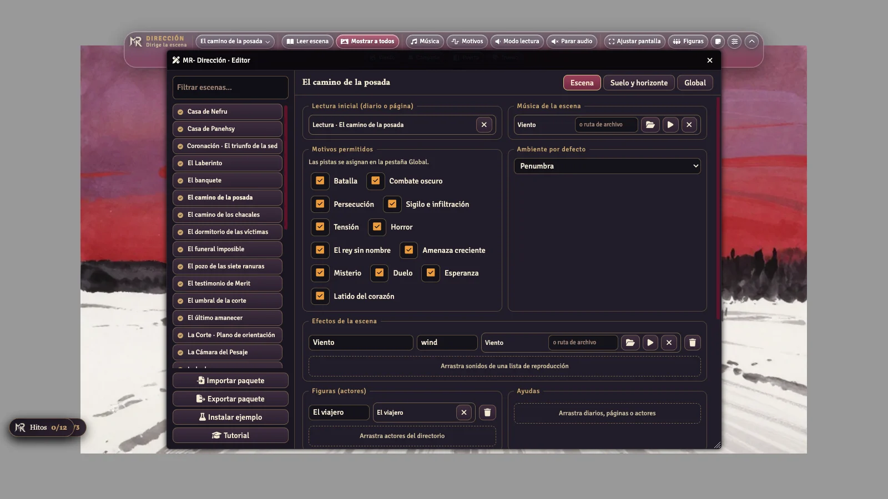

<p align="center"></p>

<p align="center">
<a href="https://github.com/ManuRomera/mr-direccion/releases/latest"></a>


<a href="https://github.com/ManuRomera/mr-direccion/releases"></a>
<a href="LICENSE"></a>
</p>

<h3 align="center">Lee la escena, muéstrala, cambia la música sin un solo corte,<br>lanza el trueno y coloca a la posadera sobre el suelo de verdad.<br>Todo desde una barra de cristal que cabe en 66 píxeles.</h3>

<p align="center"><a href="https://github.com/ManuRomera/mr-direccion/releases/latest/download/module.json"><b>⬇️ Manifest</b></a> · <a href="#-instalar"><b>⚡ Instalar</b></a> · <a href="#-crea-tu-paquete-en-10-minutos"><b>🧭 Tu paquete en 10 minutos</b></a> · <a href="docs/DISENO.md"><b>📐 Diseño y API</b></a></p>

---

<p align="center"></p>

## 🎬 Qué es

Una **barra de dirección** que solo ve el GM, nacida en *MR · El Trono de la Sed* y convertida en un módulo **independiente del sistema**. No lleva contenido: **tú (o el módulo de tu aventura) le dices qué música, qué efectos, qué personajes, qué lectura y qué ayudas van en cada escena**, sin tocar un archivo. Con un editor propio, o con un paquete JSON que se importa en un clic.

<p align="center"></p>

## ✨ Qué hace

| | |
|---|---|
| 🎞️ **Selector de escena con vista previa** | Menú propio; deja el cursor **2 s** sobre una escena y aparece su miniatura, colocada para no salirse de pantalla. |
| 📖 **Leer escena** | Abre la lectura inicial (diario o página) con **pistas clicables** `@Dir[…]` que lanzan música, efectos o ambiente. |
| 📺 **Mostrar a todos** | Activa la escena para los jugadores y arranca su música y su ambiente. |
| 🎼 **Música sin huecos** | **Fundido cruzado** (3,5 s por defecto, configurable) entre pistas, también al repetir la misma. Bucles Ogg Opus. |
| 🌩️ **Motivos y efectos** | Batalla, tensión, persecución, sigilo, horror…: lista **editable por partida**. Chips de efectos por escena y globales. |
| 🔉 **Mezcla** | Volumen, **Modo lectura** (baja el fondo), Parar audio y **ambiente** claro/penumbra/oscuro (luz y volumen a la vez, recordado por escena). |
| 🧍 **Figuras con perspectiva** | Coloca protagonistas y PNJ sobre el **suelo real** del fondo: el tamaño sale del horizonte y de los puntos de apoyo; se recalcula al arrastrar. |
| 🕯️ **Marcadores** | **Hitos secretos** que desbloquea el GM (con aviso a la mesa) y **relojes** de N segmentos solo-GM. Insignia arrastrable. |
| 🖱️ **Se coloca donde quieras** | Toda la barra se arrastra con el **botón derecho**; la posición se recuerda y se restablece. Menús que se cierran al hacer clic fuera. |
| 🪟 **Estilos** | **Cristal líquido** (por defecto) o Clásico, con o sin fondo, compacta o plegada. |
| ✏️ **Editor del GM** | Arrastra desde el directorio, marca suelo y horizonte, **Autoconfigurar**, copia de otra escena, importa y exporta. |
| 🎓 **Tutorial guiado** | Tour nativo de Foundry; se ofrece la primera vez y se repite desde Configuración → Tours. |
| ♿ **Accesible** | Roles y `aria-*`, foco visible, `prefers-reduced-motion`, es/en. |

<table>
<tr>
<td width="50%"><br><sub><b>Motivos</b> editables por partida; pulsa el activo para volver a la música de la escena.</sub></td>
<td width="50%"><br><sub><b>Vista previa</b> a los 2 s sobre una escena.</sub></td>
</tr>
<tr>
<td width="50%"><br><sub><b>Marcadores</b>: reloj de la tormenta e hitos secretos.</sub></td>
<td width="50%"><br><sub><b>Suelo y horizonte</b>: las líneas muestran la altura de una figura en cada punto.</sub></td>
</tr>
<tr>
<td width="50%"><br><sub>Estilo <b>Clásico</b>.</sub></td>
<td width="50%"><br><sub>Barra <b>sin fondo</b>.</sub></td>
</tr>
</table>

<p align="center"></p>

## ⚡ Instalar

En Foundry: **Módulos de complemento → Instalar módulo** y pega el manifest:

```
https://github.com/ManuRomera/mr-direccion/releases/latest/download/module.json
```

Funciona con **cualquier sistema** (probado con Cairn, dnd5e y Legend in the Mist en Foundry v13). Actívalo en tu mundo: aparece la barra, solo para el GM.

## 🧭 Crea tu paquete en 10 minutos

1. **Prueba el ejemplo (1 min).** Barra → ⚙ → **Editor** → **Instalar ejemplo**. Crea tres escenas, tres figuras, una lista de reproducción con audio libre y lo deja todo configurado: «La Posada del Cuervo».
2. **Abre el Editor** y elige una escena propia.
3. **Música y lectura (2 min).** Arrastra un sonido de una lista de reproducción a *Música de la escena* y un diario o página a *Lectura inicial*. También puedes escribir la ruta de un archivo de audio. O pulsa **Autoconfigurar** y revisa el borrador.
4. **Efectos y motivos (2 min).** Arrastra sonidos a *Efectos de la escena*. En la pestaña **Global** pulsa *Añadir motivos habituales* y arrastra la música de cada uno.
5. **Suelo y horizonte (2 min).** En *Suelo y horizonte* arrastra la línea punteada hasta la altura de los ojos de un personaje de pie y haz clic en el suelo para marcar dónde se pisa. Arrastra actores a *Figuras* y, en la barra, **Figuras → Colocar el reparto**.
6. **Ayudas y marcadores (2 min).** Arrastra diarios o imágenes a *Ayudas*; en Global crea hitos y relojes.
7. **Compártelo.** **Exportar paquete** guarda un JSON; **Importar paquete** lo aplica en otro mundo (las escenas se enlazan por la referencia que indique el paquete).

Una pista clicable dentro de un diario: `@Dir[motif|tension~@]{Tensión}` (el `@` es la escena actual) o `@Dir[effect|g~campana]{Campana}`.

### Paquete a mano
Ejemplo mínimo (más en [`examples/posada/pack.json`](examples/posada/pack.json) y [`docs/DISENO.md`](docs/DISENO.md)):

```json
{ "schema": 1, "id": "mi-aventura", "scenes": [
  { "ref": {"name": "La sala común"}, "music": {"src": "audio/hogar.ogg"},
    "cues": [{"label": "Puerta", "icon": "door-open", "sound": {"src": "audio/puerta.ogg"}}],
    "stage": {"eye": 0.5, "anchors": [[0.5, 0.8], [0.35, 0.9]]} } ] }
```

## 🧩 Para autores de aventuras

Tu módulo puede llevar su propia dirección y dejar de llevar su director:

```js
Hooks.once('mrDireccion.ready', async api => {
  const pack = await (await fetch('modules/mi-aventura/direccion.json')).json();
  api.registerPack(pack);          // en memoria: no escribe en el mundo
});
Hooks.on('mrDireccion.sceneChanged', (scene, cfg) => { /* … */ });
```

`registerPack`, `importPack`, `exportPack`, `dispatch(accion, arg)` y los hooks `mrDireccion.sceneChanged`, `.motif` y `.marker` están descritos en [`docs/DISENO.md`](docs/DISENO.md). Conversor desde *El Trono de la Sed*: `node tools/convert_trono.mjs <carpeta-de-trono>` genera [`examples/trono-de-la-sed.pack.json`](examples/trono-de-la-sed.pack.json) (29 escenas, 12 motivos), que se importa con el Editor.

## 🛠️ Desarrollo

```bash
npm test                 # node --test: perspectiva, fundido, geometría, esquema, migración desde Trono…
python3 tools/verify-audio.py   # Ogg Opus, ≤ 10 min, −26 LUFS
node scripts/zip.mjs     # dist/mr-direccion-vX.Y.Z.zip + module.json
```

Publicación: etiqueta `vX.Y.Z` → el workflow ejecuta los tests, empaqueta y sube `module.json` + zip a la release.

## 📜 Créditos y licencias
Código: MIT. Imágenes y audio del paquete de ejemplo: obra propia, CC BY 4.0 (atribución a Manu Romera). Diseño de la barra: *MR · El Trono de la Sed*. Hecho por [Manu Romera](https://github.com/ManuRomera).
