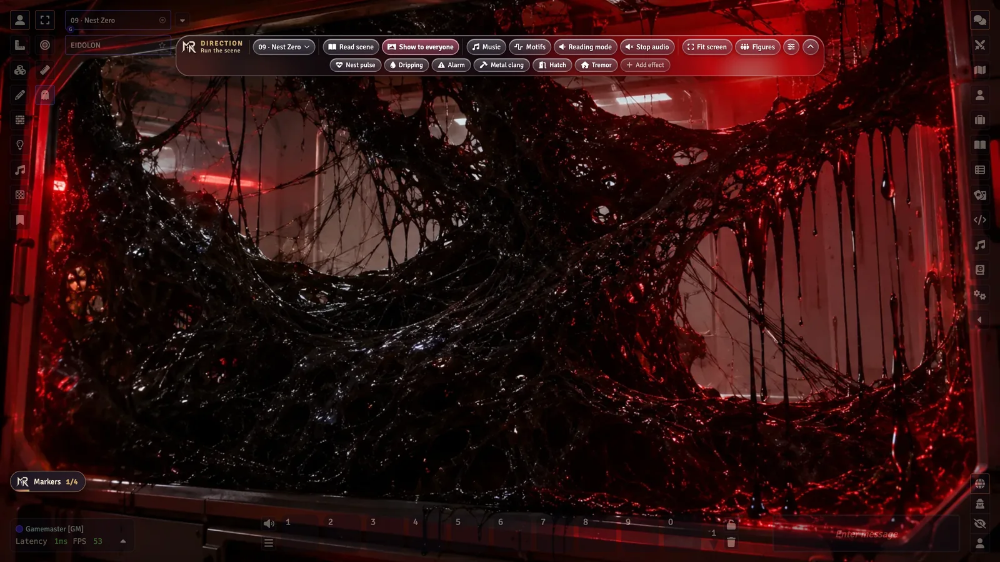
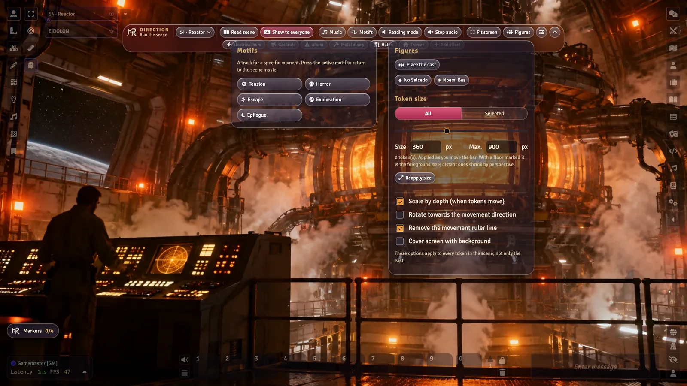
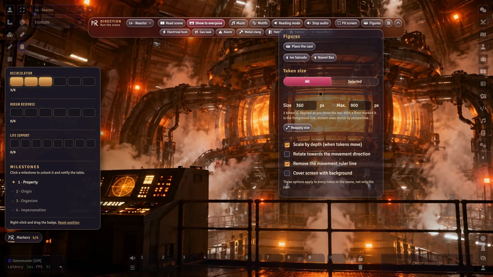
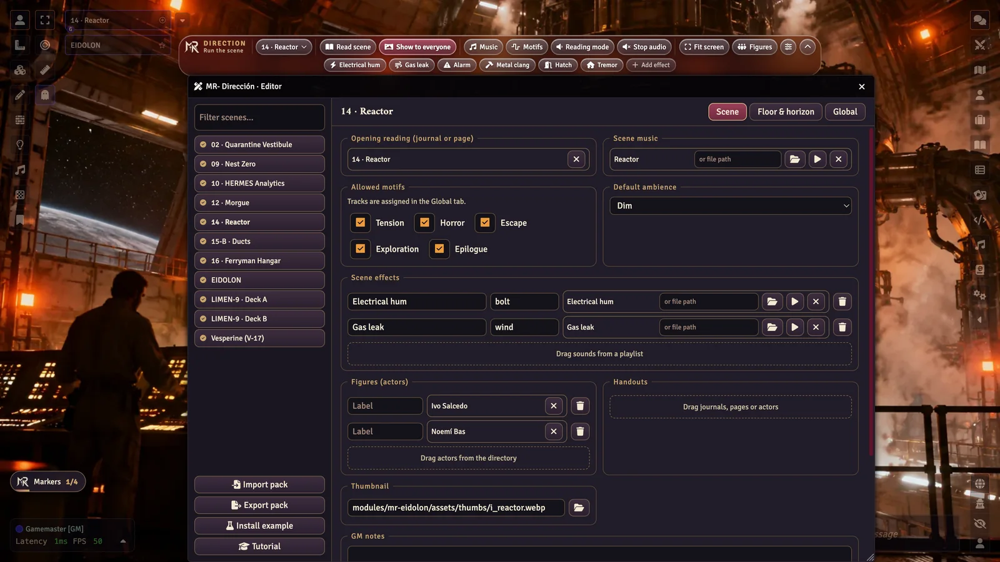

<p align="center"></p>

<p align="center">
<a href="https://github.com/ManuRomera"></a>
  <a href="https://github.com/ManuRomera/mr-direccion/releases/latest"></a>


<a href="https://github.com/ManuRomera/mr-direccion/releases"></a>
<a href="LICENSE"></a>
</p>


<h3 align="center">Lee la escena, muéstrala, cambia la música sin un solo corte,<br>lanza el trueno y coloca a la posadera sobre el suelo de verdad.<br>Todo desde una barra de cristal que cabe en 66 píxeles.</h3>
<h3 align="center">Read the scene, show it, change the music without a single gap,<br>fire the thunder and stand the innkeeper on the real floor.<br>All from a glass bar 66 pixels tall.</h3>

<p align="center"><b>🇪🇸 <a href="#-castellano">Castellano</a></b> &nbsp;·&nbsp; <b>🇬🇧 <a href="#-english">English</a></b> &nbsp;·&nbsp; <a href="https://github.com/ManuRomera/mr-direccion/releases/latest/download/module.json"><b>⬇️ Manifest</b></a><br><sub>Interfaz, tutorial y ejemplo en los dos idiomas · Interface, tour and example in both languages</sub></p>

---

<p align="center"></p>

## 🇪🇸 Castellano

<p align="center"><a href="#-instalar"><b>⚡ Instalar</b></a> · <a href="#-crea-tu-paquete-en-10-minutos"><b>🧭 Tu paquete en 10 minutos</b></a> · <a href="docs/DISENO.md"><b>📐 Diseño y API</b></a></p>

### 🎬 Qué es

Una **barra de dirección** que solo ve el GM, nacida en *MR · El Trono de la Sed* y convertida en un módulo **independiente del sistema**. No lleva contenido: **tú (o el módulo de tu aventura) le dices qué música, qué efectos, qué personajes, qué lectura y qué ayudas van en cada escena**, sin tocar un archivo. Con un editor propio, o con un paquete JSON que se importa en un clic.

<p align="center"></p>

<p align="center"><sub>Capturas reales en un mundo con <i>MR · El Trono de la Sed</i>: 29 escenas, 12 motivos y el reparto colocado por perspectiva.</sub></p>

### ✨ Qué hace

| | |
|---|---|
| 🎞️ **Selector de escena con vista previa** | Menú propio; deja el cursor **1 s** sobre una escena y aparece su miniatura, colocada para no salirse de pantalla. |
| 🗂️ **Carpetas y escenas ocultas** | El menú agrupa por carpetas (la de la escena actual, resaltada y abierta) y deja **ocultar** escenas o carpetas que aún no hacen falta, con un ojo; se recuperan con «mostrar lo oculto». |
| ↔️ **Barra horizontal o vertical** | Un botón la pasa a **vertical** para los márgenes izquierdo o derecho; se arrastra con el botón derecho y recuerda su sitio en cada orientación. |
| 📖 **Leer escena** | Abre la lectura inicial (diario o página) con **pistas clicables** `@Dir[…]` que lanzan música, efectos o ambiente. |
| 📺 **Mostrar a todos** | Activa la escena para los jugadores y arranca su música y su ambiente. |
| 🎼 **Música sin huecos** | **Fundido cruzado** (3,5 s por defecto, configurable) entre pistas, también al repetir la misma. Bucles Ogg Opus. |
| ⚡ **Asignar audio al vuelo** | Lo que aún no tiene audio sale translúcido: púlsalo y elige un sonido (con buscador y ▶ para oírlo) sin abrir el editor. |
| 🌩️ **Motivos y efectos** | Batalla, tensión, persecución, sigilo, horror…: lista **editable por partida**. Chips de efectos por escena y globales, como interruptores: se ve claramente cuáles suenan. |
| 🔉 **Mezcla** | Volumen, **Modo lectura** (baja el fondo), Parar audio y **ambiente** claro/penumbra/oscuro (luz y volumen a la vez, recordado por escena). |
| 📏 **Barra de tamaño** | Deslizador en px (máximo editable) que actúa en directo sobre **Todas** o sobre las **Seleccionadas**; giro hacia el movimiento y quitar la línea de desplazamiento, para todas las fichas de la escena. |
| 🧍 **Figuras con perspectiva** | Coloca protagonistas y PNJ sobre el **suelo real** del fondo: el tamaño sale del horizonte y de los puntos de apoyo; se recalcula al arrastrar. |
| 🕯️ **Marcadores** | **Hitos secretos** que desbloquea el GM (con aviso a la mesa) y **relojes** de N segmentos solo-GM. Insignia arrastrable. |
| 🖱️ **Se coloca donde quieras** | Toda la barra se arrastra con el **botón derecho**; la posición se recuerda y se restablece. Menús que se cierran al hacer clic fuera. |
| 🪟 **Estilos** | **Cristal líquido** (por defecto) o Clásico, con o sin fondo, compacta o plegada. |
| ✏️ **Editor del GM** | Arrastra desde el directorio, marca suelo y horizonte, **Autoconfigurar**, copia de otra escena, importa y exporta. |
| 🎓 **Tutorial guiado** | Tour nativo de Foundry en castellano o inglés; se ofrece la primera vez y se repite desde Configuración → Tours. |
| ♿ **Accesible** | Roles y `aria-*`, foco visible, `prefers-reduced-motion`, es/en. |

<table>
<tr>
<td width="50%"><br><sub><b>Motivos</b> editables por partida; pulsa el activo para volver a la música de la escena.</sub></td>
<td width="50%"><br><sub><b>Vista previa</b> al cabo de 1 s sobre una escena.</sub></td>
</tr>
<tr>
<td width="50%"><br><sub><b>Marcadores</b>: reloj de las siete lámparas e hitos secretos.</sub></td>
<td width="50%"><br><sub><b>Suelo y horizonte</b>: las líneas muestran la altura de una figura en cada punto.</sub></td>
</tr>
<tr>
<td width="50%"><br><sub>Estilo <b>Clásico</b>.</sub></td>
<td width="50%"><br><sub>Barra <b>sin fondo</b>.</sub></td>
</tr>
</table>

<p align="center"></p>

### ⚡ Instalar

En Foundry: **Módulos de complemento → Instalar módulo** y pega el manifest:

```
https://github.com/ManuRomera/mr-direccion/releases/latest/download/module.json
```

Funciona con **cualquier sistema** (probado con Cairn, dnd5e, Legend in the Mist y Mothership en Foundry v13). Actívalo en tu mundo: aparece la barra, solo para el GM.

### 🧭 Crea tu paquete en 10 minutos

1. **Prueba el ejemplo (1 min).** Barra → ⚙ → **Editor** → **Instalar ejemplo**. Crea tres escenas, tres figuras, una lista de reproducción con audio libre y lo deja todo configurado: «La Posada del Cuervo».
2. **Abre el Editor** y elige una escena propia.
3. **Música y lectura (2 min).** Arrastra un sonido de una lista de reproducción a *Música de la escena* y un diario o página a *Lectura inicial*. También puedes escribir la ruta de un archivo de audio. O pulsa **Autoconfigurar** y revisa el borrador.
4. **Efectos y motivos (2 min).** Arrastra sonidos a *Efectos de la escena*. En la pestaña **Global** pulsa *Añadir motivos habituales* y arrastra la música de cada uno.
5. **Suelo y horizonte (2 min).** En *Suelo y horizonte* arrastra la línea punteada hasta la altura de los ojos de un personaje de pie y haz clic en el suelo para marcar dónde se pisa. Arrastra actores a *Figuras* y, en la barra, **Figuras → Colocar el reparto**.
6. **Ayudas y marcadores (2 min).** Arrastra diarios o imágenes a *Ayudas*; en Global crea hitos y relojes.
7. **Compártelo.** **Exportar paquete** guarda un JSON; **Importar paquete** lo aplica en otro mundo (las escenas se enlazan por la referencia que indique el paquete).

Una pista clicable dentro de un diario: `@Dir[motif|tension~@]{Tensión}` (el `@` es la escena actual) o `@Dir[effect|g~campana]{Campana}`.

#### Paquete a mano
Ejemplo mínimo (más en [`examples/posada/pack.json`](examples/posada/pack.json) y [`docs/DISENO.md`](docs/DISENO.md)):

```json
{ "schema": 1, "id": "mi-aventura", "scenes": [
  { "ref": {"name": "La sala común"}, "music": {"src": "audio/hogar.ogg"},
    "cues": [{"label": "Puerta", "icon": "door-open", "sound": {"src": "audio/puerta.ogg"}}],
    "stage": {"eye": 0.5, "anchors": [[0.5, 0.8], [0.35, 0.9]]} } ] }
```

### 🧩 Para autores de aventuras

Tu módulo puede llevar su propia dirección y dejar de llevar su director:

```js
Hooks.once('mrDireccion.ready', async api => {
  const pack = await (await fetch('modules/mi-aventura/direccion.json')).json();
  api.registerPack(pack);          // en memoria: no escribe en el mundo
});
Hooks.on('mrDireccion.sceneChanged', (scene, cfg) => { /* … */ });
```

`registerPack`, `importPack`, `exportPack`, `dispatch(accion, arg)` y los hooks `mrDireccion.sceneChanged`, `.motif` y `.marker` están descritos en [`docs/DISENO.md`](docs/DISENO.md). Conversor desde *El Trono de la Sed*: `node tools/convert_trono.mjs <carpeta-de-trono>` genera [`examples/trono-de-la-sed.pack.json`](examples/trono-de-la-sed.pack.json) (29 escenas, 12 motivos), que se importa con el Editor. Aventuras que ya la usan: [MR- EIDOLON](https://github.com/ManuRomera/mr-eidolon) (Mothership, ES/EN) y [MR- La Rima de la Doncella](https://github.com/ManuRomera/mr-doncella-escarcha).

### 🛠️ Desarrollo

```bash
npm test                 # node --test: perspectiva, fundido, geometría, esquema, migración desde Trono…
python3 tools/verify-audio.py   # Ogg Opus, ≤ 10 min, −26 LUFS
node scripts/zip.mjs     # dist/mr-direccion-vX.Y.Z.zip + module.json
```

Publicación: etiqueta `vX.Y.Z` → el workflow ejecuta los tests, empaqueta y sube `module.json` + zip a la release.

### 📜 Créditos y licencias
Código: MIT. Imágenes y audio del paquete de ejemplo: obra propia, CC BY 4.0 (atribución a Manu Romera). Diseño de la barra: *MR · El Trono de la Sed*. Hecho por [Manu Romera](https://github.com/ManuRomera).

---

## 🇬🇧 English

<p align="center"><a href="#-install"><b>⚡ Install</b></a> · <a href="#-your-pack-in-10-minutes"><b>🧭 Your pack in 10 minutes</b></a> · <a href="docs/DESIGN.md"><b>📐 Design and API</b></a></p>

### 🎬 What it is

A GM-only **direction bar**, born in *MR · The Throne of Thirst* and turned into a **system-agnostic** module. It ships no content: **you (or your adventure module) tell it which music, effects, characters, read-aloud text and handouts belong to each scene**, without touching a file. With its own editor, or with a JSON pack imported in one click.

<p align="center"></p>

<p align="center"><sub>Real captures in English in a world with <i>MR- EIDOLON</i> (Mothership): nine image scenes, five motifs, three clocks and four milestones.</sub></p>

### ✨ What it does

| | |
|---|---|
| 🎞️ **Scene picker with preview** | Its own menu; rest the cursor on a scene for **1 s** and its thumbnail appears, placed so it never leaves the screen. |
| 🗂️ **Folders and hidden scenes** | The menu groups scenes by folder (the current scene's folder is highlighted and kept open) and lets you **hide** scenes or folders you don't need yet with an eye button; bring them back with “show hidden”. |
| ↔️ **Horizontal or vertical bar** | One button turns it **vertical** for the left or right margin; drag it with the right button and it remembers its place in each orientation. |
| 📖 **Read scene** | Opens the read-aloud text (journal or page) with **clickable cues** `@Dir[…]` that fire music, effects or ambience. |
| 📺 **Show to everyone** | Activates the scene for the players and starts its music and ambience. |
| 🎼 **Gapless music** | **Crossfade** (3.5 s by default, configurable) between tracks, even when replaying the same one. Ogg Opus loops. |
| ⚡ **Assign audio on the fly** | Anything without audio shows translucent: press it and pick a sound (with search and ▶ preview) without opening the editor. |
| 🌩️ **Motifs and effects** | Battle, tension, chase, stealth, horror…: an **editable list per world**. Scene and global effect chips work as toggles, so you always see which ones are playing. |
| 🔉 **Mix** | Volume, **Reading mode** (ducks the background), Stop audio and **ambience** light/dim/dark (lighting and volume at once, remembered per scene). |
| 📏 **Size bar** | A px slider (editable maximum) that works live on **All** or **Selected** tokens; turn toward movement and remove the movement ruler, for every token in the scene. |
| 🧍 **Figures in perspective** | Place PCs and NPCs on the **real floor** of the background: size comes from the horizon and the floor anchors and is recomputed while dragging. |
| 🕯️ **Markers** | **Secret milestones** the GM unlocks (with a notice to the table) and GM-only **clocks** of N segments. Draggable badge. |
| 🖱️ **Put it anywhere** | Drag the whole bar with the **right mouse button**; the position is remembered and can be reset. Menus close when you click outside. |
| 🪟 **Styles** | **Liquid Glass** (default) or Classic, with or without background, compact or folded. |
| ✏️ **GM editor** | Drag from the sidebar, mark floor and horizon, **Auto-configure**, copy from another scene, import and export. |
| 🎓 **Guided tour** | Native Foundry tour in English or Spanish, offered the first time and repeatable from Settings → Tours. |
| ♿ **Accessible** | Roles and `aria-*`, visible focus, `prefers-reduced-motion`, English and Spanish. |

<table>
<tr>
<td width="50%"><br><sub><b>Motifs</b>, editable per world; press the active one to return to the scene music.</sub></td>
<td width="50%"><br><sub><b>Markers</b> (three clocks and the evidence milestones) and the <b>Figures</b> menu with the size bar.</sub></td>
</tr>
<tr>
<td width="50%"><br><sub><b>Floor and horizon</b>: the lines show a figure’s height at each point.</sub></td>
<td width="50%"><br><sub><b>Preview</b> after 1 s on a scene.</sub></td>
</tr>
<tr>
<td width="50%"><br><sub><b>Classic</b> style.</sub></td>
<td width="50%"><br><sub>Bar <b>without background</b>.</sub></td>
</tr>
</table>

<p align="center"></p>

### ⚡ Install

In Foundry: **Add-on Modules → Install Module** and paste the manifest:

```
https://github.com/ManuRomera/mr-direccion/releases/latest/download/module.json
```

Works with **any system** (tested with Cairn, dnd5e, Legend in the Mist and Mothership on Foundry v13). Enable it in your world: the bar appears, GM only.

### 🧭 Your pack in 10 minutes

1. **Try the example (1 min).** Bar → ⚙ → **Editor** → **Install example**. It creates three scenes, three figures and a playlist with free audio, all configured: “The Raven Inn”.
2. **Open the Editor** and pick one of your own scenes.
3. **Music and read-aloud (2 min).** Drag a sound from a playlist into *Scene music* and a journal or page into *Opening reading*. You can also type an audio file path. Or press **Auto-configure** and review the draft.
4. **Effects and motifs (2 min).** Drag sounds into *Scene effects*. In the **Global** tab press *Add common motifs* and drag the music for each one.
5. **Floor and horizon (2 min).** In *Floor & horizon* drag the dotted line to the eye height of a standing character and click the floor to mark where people stand. Drag actors into *Figures* and, on the bar, **Figures → Place the cast**.
6. **Handouts and markers (2 min).** Drag journals or images into *Handouts*; create milestones and clocks in Global.
7. **Share it.** **Export pack** saves a JSON; **Import pack** applies it in another world (scenes are linked by the reference the pack gives).

A clickable cue inside a journal: `@Dir[motif|tension~@]{Tension}` (`@` is the current scene) or `@Dir[effect|g~bell]{Bell}`.

#### Pack by hand
Minimal example (more in [`examples/posada/pack.en.json`](examples/posada/pack.en.json) and [`docs/DESIGN.md`](docs/DESIGN.md)):

```json
{ "schema": 1, "id": "my-adventure", "scenes": [
  { "ref": {"name": "The common room"}, "music": {"src": "audio/hearth.ogg"},
    "cues": [{"label": "Door", "icon": "door-open", "sound": {"src": "audio/door.ogg"}}],
    "stage": {"eye": 0.5, "anchors": [[0.5, 0.8], [0.35, 0.9]]} } ] }
```

### 🧩 For adventure authors

Your module can ship its own direction and drop its own director:

```js
Hooks.once('mrDireccion.ready', async api => {
  const pack = await (await fetch('modules/my-adventure/direction.json')).json();
  api.registerPack(pack);          // in memory: nothing is written to the world
});
Hooks.on('mrDireccion.sceneChanged', (scene, cfg) => { /* … */ });
```

`registerPack`, `importPack`, `exportPack`, `dispatch(action, arg)` and the hooks `mrDireccion.sceneChanged`, `.motif` and `.marker` are described in [`docs/DESIGN.md`](docs/DESIGN.md). Converter from *The Throne of Thirst*: `node tools/convert_trono.mjs <trono-folder>` writes [`examples/trono-de-la-sed.pack.json`](examples/trono-de-la-sed.pack.json) (29 scenes, 12 motifs), which you import from the Editor. Adventures that already use it: [MR- EIDOLON](https://github.com/ManuRomera/mr-eidolon) (Mothership, ES/EN) and [MR- La Rima de la Doncella](https://github.com/ManuRomera/mr-doncella-escarcha).

### 🛠️ Development

```bash
npm test                 # node --test: perspective, crossfade, geometry, schema, Trono migration…
python3 tools/verify-audio.py   # Ogg Opus, ≤ 10 min, −26 LUFS
node scripts/zip.mjs     # dist/mr-direccion-vX.Y.Z.zip + module.json
```

Release: tag `vX.Y.Z` → the workflow runs the tests, packages and uploads `module.json` + zip to the release.

### 📜 Credits and licenses
Code: MIT. Images and audio of the example pack: original work, CC BY 4.0 (credit Manu Romera). Bar design: *MR · The Throne of Thirst*. Made by [Manu Romera](https://github.com/ManuRomera).
