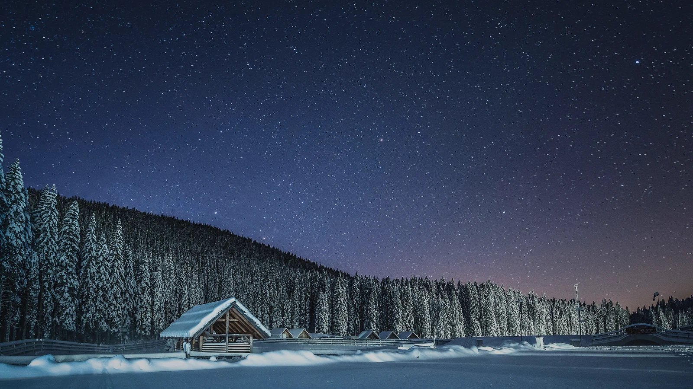
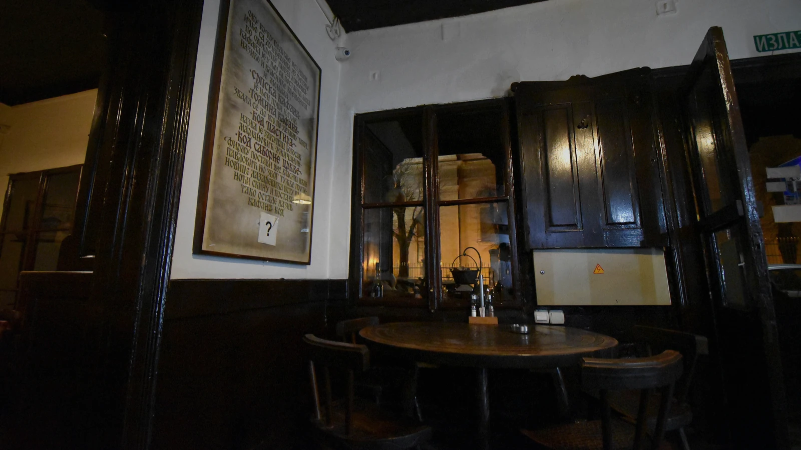
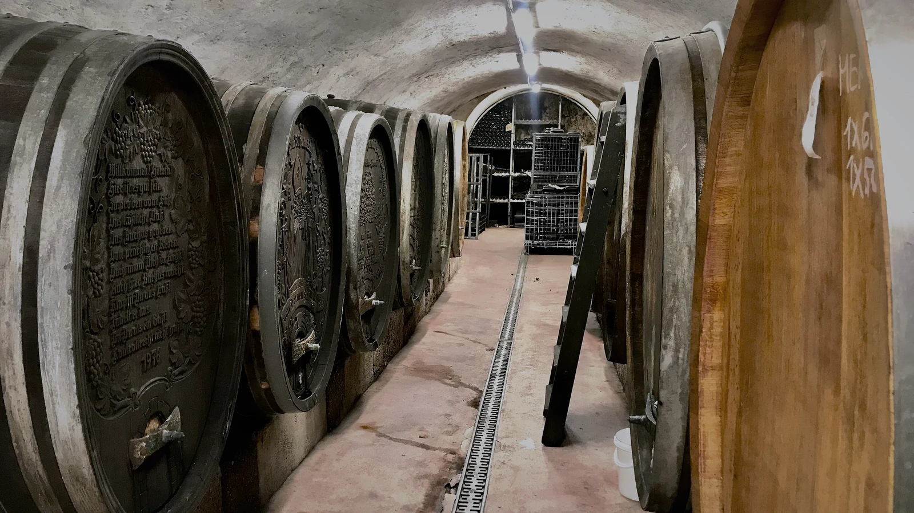
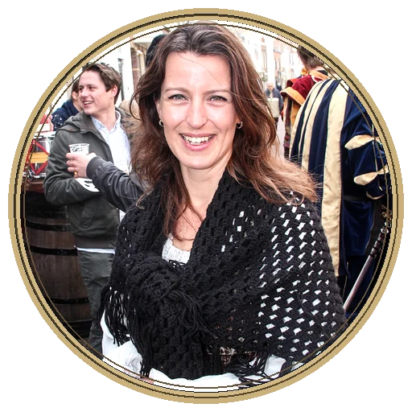
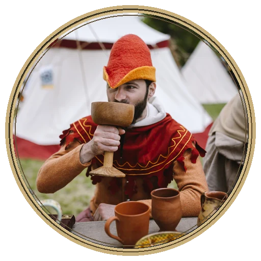
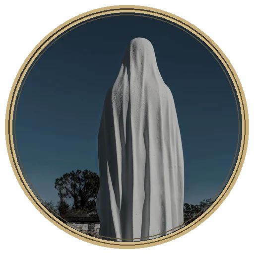

# Posada · Ejemplo fotográfico para MR · Dirección

Este es el material visual del ejemplo opcional, adaptado a los recursos de Foundry VTT v13: tres fondos 1600 × 900, tres miniaturas 400 × 225 y tres retratos/token 512 × 512.

## Fondos de escena

**El camino hasta la posada** — fotografía de Dreamy Pixel ([CC BY 4.0](https://creativecommons.org/licenses/by/4.0/)).

**La sala común** — fotografía de Fred Cherrygarden ([CC BY-SA 4.0](https://creativecommons.org/licenses/by-sa/4.0/)).

**La bodega** — fotografía de Naturpuur ([CC BY 4.0](https://creativecommons.org/licenses/by/4.0/)).

## Personajes de ejemplo

| Posadera | Viajero | Sombra |
|---|---|---|
|  |  |  |
| Peter van der Sluijs | Shixart1985 | Bart Everson |
| CC BY-SA 3.0 | CC BY 2.0 | CC BY 2.0 |

Las personas retratadas no están asociadas a MR · Dirección ni lo recomiendan. **Todos los créditos, licencias de las fotografías originales y descripción de las adaptaciones:** [ASSET_CREDITS.md](../examples/posada/ASSET_CREDITS.md).

Las imágenes son material ilustrativo del ejemplo. MR · Dirección sigue siendo compatible con cualquier sistema y cualquier mundo; no necesita estos recursos para funcionar.
